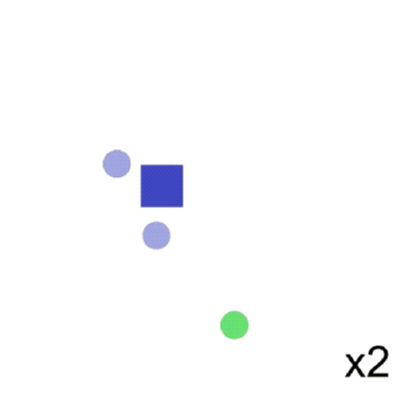

# マルチエージェント強化学習による協調搬送

複数台のロボットが協力して、1台では動かせない重い荷物をゴールまで運ぶタスクを、マルチエージェント強化学習（MARL）で学習させました。

- シミュレータ：[VMAS](https://github.com/proroklab/VectorizedMultiAgentSimulator)（PyTorch で並列化された 2D マルチエージェント物理シミュレータ）
- 学習フレームワーク：[BenchMARL](https://github.com/facebookresearch/BenchMARL)（MAPPO、MADDPG などの MARL アルゴリズムを Hydra で切り替えて実験できる）



*学習した方策で、2台のロボット（薄い青の円）が協力して箱（青の四角）をゴール（緑の円）まで運ぶ様子（2倍速）。*

## 取り組んだ内容

BenchMARL に、独自の協調搬送タスクを2つ追加しました。

### 1. 協調搬送タスク（`my_vmas/my_transport`）

- 2台のロボットが、重い箱（質量 10）を押してゴールまで運びます。
- **報酬**：箱とゴールの距離が縮んだ分だけ報酬を与える（progress reward）ほか、ゴールに着くまでは毎ステップ小さなペナルティ（-0.01）を与えて、早く運ぶように促します。
- **観測**：ゴールから見た箱の相対位置、自分から見た箱の相対位置、箱の速度、自分の位置と速度など。
- 実装：`BenchMARL/benchmarl/environments/my_vmas/my_transport.py`

### 2. 論文の再現実装：イベントトリガー型の通信と制御（`my_vmas_rotate/my_transport_rotate`）

次の論文の手法を、VMAS と BenchMARL の上で再現しようとしました。

> Deep Reinforcement Learning of Event-Triggered Communication and Control for Multi-Agent Cooperative Transport, ICRA 2021

ロボット同士が常に通信するのではなく、必要なときだけ通信するように、通信と制御を同時に学習させる手法です。1 のタスクを次のように拡張しました。

- 箱が回転するようにし、箱の位置・速度・角度・角速度を観測に加えました。
- 各ロボットは、移動の力に加えて「**誰と通信するか**」と「**何を共有するか**（位置 / 速度 / 行動）」も行動として出力します。通信を選んだ相手の情報だけが観測に入り、選ばなかった情報は -1 で隠されます。
- 通信量に応じたペナルティ（λ = 0.1）を報酬に加え、必要なときだけ通信するように学習させます。
- 実装：`BenchMARL/benchmarl/environments/my_vmas_rotate/my_transport_rotate.py`

学習はうまくいかず、論文と同等の搬送と通信の削減は再現できませんでした。


## リポジトリ構成

```
cooperativeTransport/
├── BenchMARL/                       # BenchMARL（独自タスクを追加して改変）
│   └── benchmarl/
│       ├── environments/
│       │   ├── my_vmas/             # 協調搬送タスク
│       │   └── my_vmas_rotate/      # 回転・通信ありの協調搬送タスク
│       └── conf/
│           ├── config.yaml          # 協調搬送タスクの学習設定
│           ├── config_rotate.yaml   # 回転・通信ありのタスクの学習設定
│           ├── task/my_vmas*/       # タスクのパラメータ（ロボット数、箱の数・質量）
│           ├── experiment/          # 学習ステップ数、評価間隔、ロガーなど
│           └── model/               # actor / critic のネットワーク
├── VectorizedMultiAgentSimulator/   # VMAS のソースコード
├── Practice/                        # VMAS と BenchMARL の練習用コード
└── pyproject.toml                   # uv のワークスペース設定
```

`BenchMARL/` と `VectorizedMultiAgentSimulator/` は、それぞれのリポジトリをコピーしたものです。

## 動作環境

- Python 3.10
- [uv](https://docs.astral.sh/uv/)
